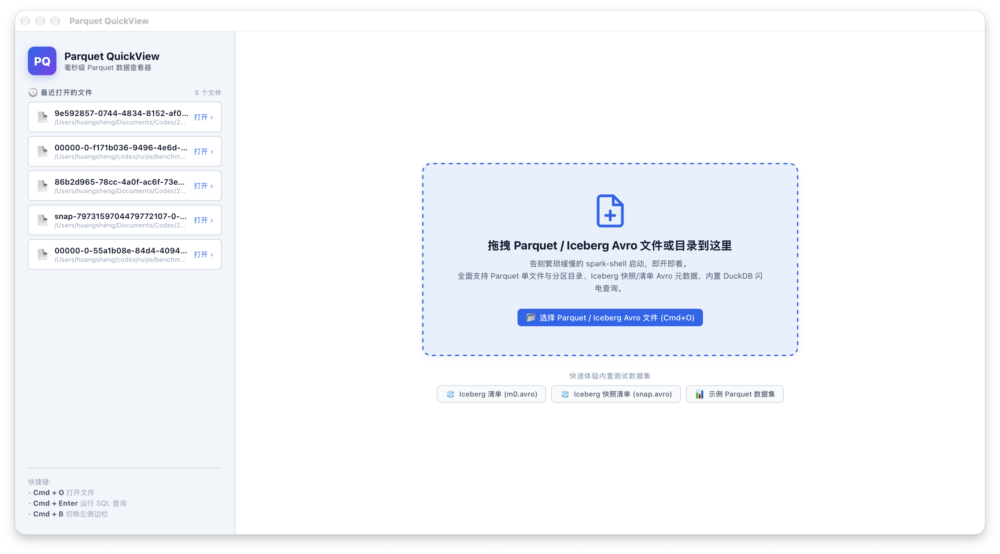
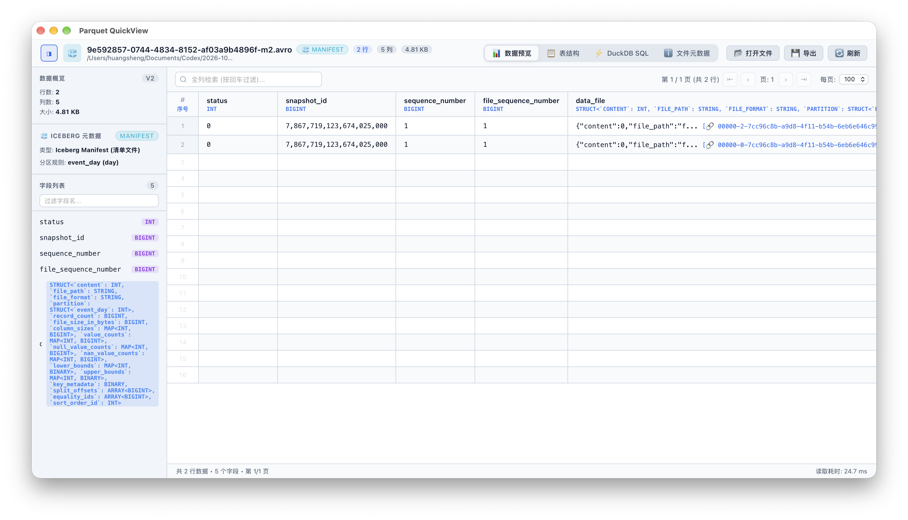
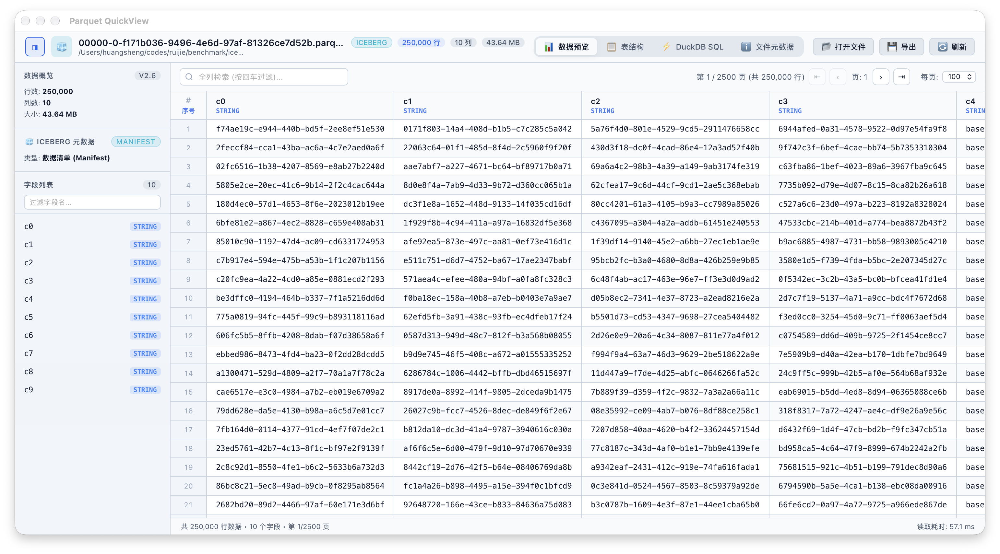
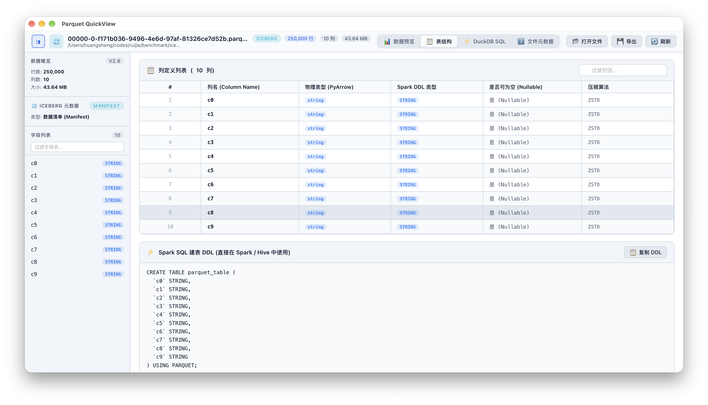
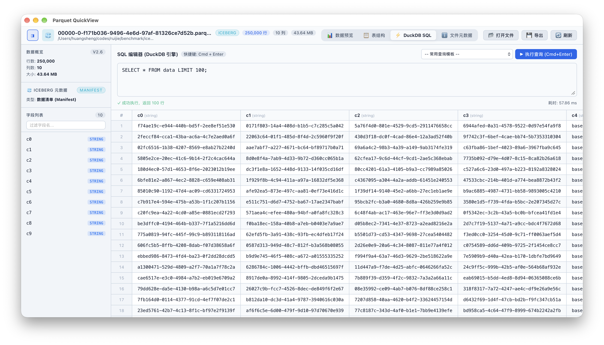
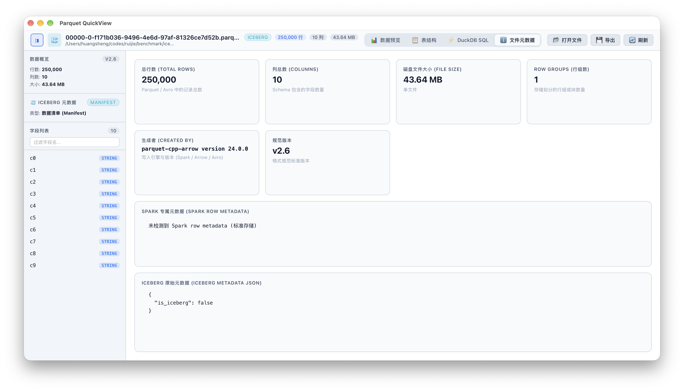

# Parquet QuickView 🧊📊

> 专为数据工程师打造的 macOS 极速 Parquet 与 Apache Iceberg Avro 数据查看器。  
> 告别漫长繁琐的 `spark-shell` 启动等待，即开即看，毫秒级响应。

---

## 🌟 为什么需要 Parquet QuickView？

日常大数据排查与研发中，我们经常需要快速确认 Parquet 文件或 Iceberg 元数据的内容、Schema、行数与分区分布。传统的做法是每次都要等待十几秒甚至几分钟启动 `spark-shell`，敲上一长串 `spark.read.parquet(...)`、`df.show()`、`df.printSchema()` 命令，流程非常繁琐。

**Parquet QuickView** 采用 **Swift 原生框架 + DuckDB / PyArrow / FastAvro** 高性能底座，提供轻量、现代、开箱即用的 macOS 原生桌面体验：
- **0 秒启动**：双击即可毫秒级打开任意 Parquet 或 Iceberg Avro 文件。
- **全格式支持**：单文件、Spark 多分区目录（`part-*.parquet`）、Iceberg Manifest 数据清单与 Snapshot 快照清单。
- **关联文件一键穿透**：快照清单一键跳转 Manifest，Manifest 一键跳转并打开底层 Parquet 数据文件。
- **交互式 SQL Studio**：内置嵌入式 DuckDB 分析引擎，支持任意 SQL 查询与聚合统计。

---

## 🖼️ 界面预览 (Screenshots)

### 1. 欢迎首页与拖拽直开 (Welcome & Drop Zone)
> 支持拖拽单个文件、整个 Spark 多分片目录，或一键体验内置测试集。



---

### 2. Iceberg Manifest 清单与关联文件一键穿透 (Iceberg Manifest & File Jump)
> 自动解析 Iceberg 快照、序列号与嵌套分区结构，点击关联的 Parquet 数据文件路径即可一键穿透打开！



---

### 3. 百万级数据极速分页与检索 (Large Dataset Preview)
> 25 万行数据集打开渲染仅需 57ms，列宽自适应，支持全列搜索与列点击快速排序。



---

### 4. 字段结构与 DDL 逆向还原 (Schema View & DDL)
> 自动解析物理存储编码与逻辑类型，并实时生成规范的 Spark SQL / Iceberg SQL 建表 DDL 与 PySpark 代码。



---

### 5. DuckDB 交互式 SQL 分析引擎 (DuckDB SQL Studio)
> 毫秒级执行任意复杂 SQL 查询，支持直接查询嵌套 Struct 属性，支持结果导出为 CSV / JSON / Parquet。



---

### 6. 文件元数据看板 (File Metadata & Statistics)
> 详细呈现磁盘大小、总行数、列数、Parquet Row Groups、压缩算法与 Spark/Iceberg 附加元数据。



---

## ✨ 核心特性

- **🚀 毫秒级极速渲染**：基于 DuckDB 与 PyArrow，百万行数据集按需分页、列宽自适应，丝滑流畅。
- **🧊 Apache Iceberg 深度集成**：
  - 自动识别并解析 Iceberg Manifest（清单）与 Manifest List（快照列表）。
  - 深度提取 Snapshot ID、Parent Snapshot ID、Sequence Number、Partition Spec 等关键元数据。
  - 逆向还原 Iceberg 业务数据表结构并生成规范的 **Iceberg SQL 建表 DDL**。
- **📋 表结构与 DDL 逆向生成**：
  - 完整呈现字段类型、物理存储类型、是否可为空、压缩编码。
  - 一键复制标准 **Spark SQL DDL** 与 **PySpark StructType** 代码。
- **⚡️ 交互式 DuckDB SQL 引擎**：
  - 支持直接在界面上对当前打开的数据集执行原生 SQL 查询。
  - 支持复杂嵌套结构过滤（如 `SELECT data_file.file_path, data_file.record_count FROM data`）。
  - 支持将查询结果一键导出为 CSV、JSON 或 Parquet。
- **🍏 macOS 原生深度体验**：
  - **Universal 2 架构**：完美原生支持 Apple Silicon (M1/M2/M3/M4) 与 Intel 架构 Mac。
  - **Finder 文件关联**：支持双击 `.parquet`、`.pq`、`.avro`、`.avsc` 文件直接打开。
  - **窗口随心拖拽**：直接将文件或分区目录拖入 App 窗口。
  - **自适应深浅色模式**：完美契合 macOS 视觉规范。
  - **命令行快捷工具**：提供全局命令 `parquet-view`（别名 `pview`）。

---

## 🛠️ 项目结构

```text
ParquetViewer/
├── build.sh                  # 一键构建脚本 (自动检查安装依赖、编译二进制、安装 App)
├── package_dmg.sh            # 一键制作 macOS .dmg 安装镜像
├── requirements.txt          # Python 核心依赖 (duckdb, pyarrow, fastavro)
├── dist/                     # DMG 打包输出目录
├── assets/                   # 图标与内置示例数据
│   ├── AppIcon.icns          # 应用图标
│   └── samples/              # 内置测试数据集 (Parquet & Iceberg Avro)
└── src/
    ├── Info.plist            # macOS 应用程序配置与文件类型关联
    ├── main.swift            # Swift 原生外壳 (WebKit 容器、原生菜单、系统桥接)
    ├── parquet_engine.py     # Python 数据解析引擎 (DuckDB / PyArrow / FastAvro)
    ├── index.html            # 前端数据可视化界面与自适应布局
    └── app.js                # 数据交互逻辑、SQL 查询、分页与模态框
```

---

## 📦 一键构建与安装

### 1. 环境准备
- macOS 12.0+ (Monterey 及以上版本)
- Xcode Command Line Tools (`xcode-select --install`)
- Python 3 (`python3`)

### 2. 一键构建并安装到系统
在项目根目录下直接运行：

```bash
chmod +x build.sh package_dmg.sh
./build.sh
```

脚本将自动执行：
1. 检查并自动安装缺失的 Python 依赖库（`duckdb`、`pyarrow`、`fastavro`）。
2. 使用 `swiftc` 编译 Universal 2 双架构原生程序（`arm64` + `x86_64`）。
3. 组装 App Bundle 并安装到 `/Applications/Parquet QuickView.app`。
4. 注册系统 LaunchServices 文件关联。
5. 配置全局终端命令 `parquet-view` 与 `pview` 到 `~/.local/bin/`。

### 3. 一键打包 DMG 磁盘镜像
如需分享给其他同事或生成发布包，只需加上 `--dmg` 参数：

```bash
./build.sh --dmg
# 或者单独运行
./package_dmg.sh
```
生成的安装镜像位于：`dist/Parquet-QuickView-1.0.0.dmg`。

---

## 💻 命令行使用方式

构建完成后，可以在终端随时用 `parquet-view` 或 `pview` 秒级打开文件或目录：

```bash
# 打开单个 Parquet 文件
parquet-view /path/to/data.parquet

# 打开 Spark 分区目录 (包含多片 part-*.parquet)
parquet-view /path/to/spark_output/

# 打开 Iceberg Avro 清单文件
pview /path/to/metadata/86b2d965-78cc-4a0f-ac6f-73e90976463e-m0.avro

# 打开 Iceberg Avro 快照文件
pview /path/to/metadata/snap-7973159704479772107-0-86b2d965-78cc-4a0f-ac6f-73e90976463e.avro
```

---

## ⌨️ 常用快捷键

| 快捷键 | 功能说明 |
| :--- | :--- |
| **Cmd + O** | 弹出原生文件选择对话框 |
| **Cmd + Enter** | 在 SQL Studio 中执行当前 SQL 查询 |
| **Cmd + B** | 切换显示 / 隐藏左侧字段边栏 |
| **Cmd + R** | 刷新重载当前文件 |
| **Cmd + W** | 关闭当前窗口 |
| **Cmd + Q** | 退出应用程序 |

---

## 📄 开源协议

本项目采用 [MIT License](LICENSE) 开源协议。
